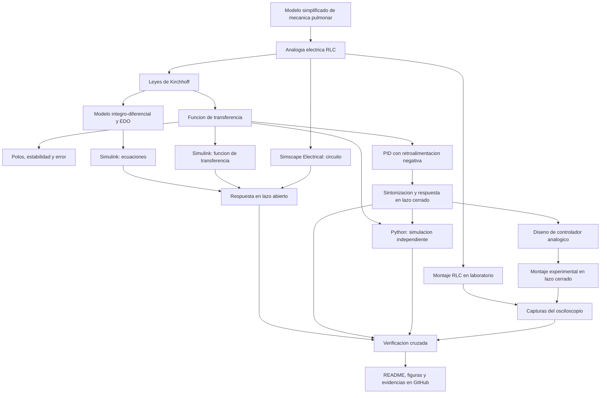

[](https://matlab.mathworks.com/open/github/v1?repo=DrPaulValle/MSFBP0)

# Práctica 0 — Modelo de mecánica pulmonar de segundo orden

Repositorio académico de la asignatura **Modelado de Sistemas Fisiológicos**, correspondiente al programa de **Ingeniería Biomédica** del Tecnológico Nacional de México / Instituto Tecnológico de Tijuana. Esta práctica introductoria integra modelado matemático, analogías eléctricas de sistemas fisiológicos, análisis temporal y de estabilidad, diseño de controladores PID, simulación computacional y comprobación experimental.

El caso de estudio representa la **mecánica pulmonar** mediante un circuito **RLC de segundo orden**. Se busca reproducir y comparar la respuesta de la presión alveolar $P_A(t)$ ante diferentes señales de presión aplicadas en la apertura de las vías respiratorias $P_{ao}(t)$, tanto en lazo abierto como en lazo cerrado.

**Docente:** Dr. Paul Antonio Valle Trujillo  
**Correo:** paul.valle@tectijuana.edu.mx  
**Departamento:** Ingeniería Eléctrica y Electrónica  
**Institución:** Tecnológico Nacional de México / Instituto Tecnológico de Tijuana  
**Asignatura:** Modelado de Sistemas Fisiológicos  
**Programa:** Ingeniería Biomédica  
**Estudiante:** Nombre completo · Número de control · correo@tijuana.tecnm.mx

**Repositorio de la asignatura:** https://github.com/DrPaulValle/MSF-IBF1020  
**Sede:** Blvd. Alberto Limón Padilla s/n, Tijuana, C. P. 22454, B. C., México.

---

<a id="contenido"></a>
## Contenido

1. [Resumen](#resumen)
2. [Competencia y objetivos](#objetivos)
3. [Relación con el temario](#temario)
4. [Modelo físico y analogía eléctrica](#analogia)
5. [Formulación matemática](#modelo)
6. [Análisis temporal y de estabilidad](#analisis)
7. [Señales de entrada y condiciones de simulación](#senales)
8. [Implementación en MATLAB, Simulink y Simscape](#matlab)
9. [Control en lazo cerrado y sintonización PID](#pid)
10. [Reproducción en Python](#python)
11. [Controlador analógico y laboratorio](#laboratorio)
12. [Resultados y verificación cruzada](#resultados)
13. [Flujo de trabajo](#flujo)
14. [Actividades del estudiante](#actividades)
15. [Estructura del repositorio](#estructura)
16. [Requisitos](#requisitos)
17. [Reproducibilidad y entregables](#reproducibilidad)
18. [Referencias](#referencias)

---

<a id="resumen"></a>
## Resumen

La práctica tiene como propósito **reproducir un procedimiento completo de modelado, análisis, simulación y control** de un sistema fisiológico utilizando resultados y materiales de referencia. La mecánica del sistema respiratorio se aproxima mediante una resistencia $R$, una inertancia $L$ y una compliancia $C$, representadas por un circuito eléctrico de segundo orden. A partir de las leyes de Kirchhoff se obtiene un modelo integro-diferencial, su función de transferencia y una representación equivalente mediante ecuaciones diferenciales ordinarias de primer orden.

Se estudian el error en estado estacionario y la estabilidad del modelo a través de sus polos. Posteriormente se aplican cuatro entradas de referencia —escalón, pulso, rampa y senoide— y se contrastan tres implementaciones en MATLAB/Simulink/Simscape. Se incorpora un **controlador PID con retroalimentación negativa**, cuyas ganancias se sintonizan a partir de criterios explícitos de tiempo de establecimiento y sobreimpulso. Los resultados se reproducen mediante Python y se comparan con la construcción física del circuito y las mediciones registradas en el Laboratorio de Electrónica.

Esta es una **práctica de reproducción y verificación**: se espera que el estudiante explique los resultados suministrados, identifique la correspondencia entre representaciones y distinga claramente cualquier aporte o modificación propia.

**Palabras clave:** circuito RLC; controlador PID; mecánica pulmonar; modelado de sistemas fisiológicos; MATLAB; Simulink; Simscape Electrical; Python; simulación *in silico*; instrumentación electrónica.

[Volver al contenido](#contenido)

---

<a id="objetivos"></a>
## Competencia y objetivos

### Competencia a desarrollar

Comprender los conceptos básicos de Ingeniería de Control, la respuesta temporal y los criterios de estabilidad mediante la reproducción y verificación de un modelo matemático de segundo orden aplicado a la mecánica pulmonar. La práctica permite familiarizarse con las herramientas computacionales, los instrumentos de laboratorio y los mecanismos de documentación empleados en actividades posteriores.

### Objetivo general

Reproducir y verificar el modelo de segundo orden de la mecánica pulmonar mediante su formulación matemática, implementación computacional, control con retroalimentación y emulación experimental, comparando las respuestas obtenidas ante señales de entrada previamente definidas.

### Objetivos específicos

- Identificar la entrada, la salida, el flujo de aire y los parámetros del circuito equivalente.
- Obtener la función de transferencia del sistema a partir de las leyes de Kirchhoff y la transformada de Laplace.
- Formular las ecuaciones integro-diferenciales y su representación equivalente como sistema de ecuaciones diferenciales ordinarias lineales de primer orden.
- Determinar el error en estado estacionario para una entrada escalón y analizar la estabilidad mediante los polos de la planta.
- Simular el modelo con ecuaciones integro-diferenciales, función de transferencia y componentes de Simscape Electrical.
- Comparar las respuestas ante escalón, pulso, rampa y señal sinusoidal.
- Implementar un controlador PID y sintonizar sus ganancias para cumplir los criterios de desempeño establecidos.
- Reproducir las respuestas de lazo abierto y lazo cerrado mediante MATLAB y Python.
- Construir y evaluar el circuito equivalente y el controlador analógico en el laboratorio.
- Documentar los resultados numéricos y experimentales en un repositorio de GitHub.

[Volver al contenido](#contenido)

---

<a id="temario"></a>
## Relación con el temario

La práctica integra contenidos correspondientes a tres unidades de la asignatura **Modelado de Sistemas Fisiológicos (IBF-1020)**:

| Unidad | Área | Contenidos aplicados |
|---|---|---|
| I | Sistemas de control retroalimentados | Elementos del sistema de control, diagramas de bloques, respuesta ante distintas entradas, análisis de error y criterios de estabilidad |
| II | Modelado matemático | Analogía circuito–sistema respiratorio, leyes de Kirchhoff, modelo de segundo orden y función de transferencia |
| III | Controladores | Tipos de controladores, diseño del PID y sintonización de ganancias |

El enfoque combina **Ingeniería de Control, Electrónica Analógica, Ciencias de la Computación y Fisiología**, de acuerdo con la competencia general de la asignatura.

[Volver al contenido](#contenido)

---

<a id="analogia"></a>
## Modelo físico y analogía eléctrica

El sistema respiratorio se aproxima mediante un circuito RLC: la resistencia representa la oposición al flujo de aire en las vías respiratorias, el tejido pulmonar y la pared torácica; la inductancia representa la inertancia; y la capacitancia representa la compliancia, es decir, la capacidad de almacenar volumen ante cambios de presión.

| Símbolo | Equivalente eléctrico | Interpretación fisiológica |
|---|---|---|
| $P_{ao}(t)$ | Voltaje de entrada | Presión aplicada en la apertura de las vías respiratorias |
| $P_A(t)$ | Voltaje de salida | Presión alveolar |
| $Q(t)$ | Corriente | Flujo de aire |
| $R$ | Resistencia | Resistencia equivalente al flujo de aire |
| $L$ | Inductancia | Inertancia del flujo de aire |
| $C$ | Capacitancia | Compliancia pulmonar equivalente |

### Parámetros para la emulación eléctrica

| Parámetro | Valor | Unidad eléctrica | Unidad fisiológica análoga |
|---|---:|---|---|
| $R$ | $10\,000$ | $\Omega$ ($10\,\mathrm{k}\Omega$) | $\mathrm{cmH_2O}\cdot\mathrm{s}\cdot\mathrm{L}^{-1}$ |
| $L$ | $1\times10^{-6}$ | $\mathrm{H}$ ($1\,\mu\mathrm{H}$) | $\mathrm{cmH_2O}\cdot\mathrm{s}^{2}\cdot\mathrm{L}^{-1}$ |
| $C$ | $220\times10^{-6}$ | $\mathrm{F}$ ($220\,\mu\mathrm{F}$) | $\mathrm{L}\cdot(\mathrm{cmH_2O})^{-1}$ |

Las variables de presión se expresan en $\mathrm{cmH_2O}$ en su interpretación fisiológica y en voltios durante la emulación; el flujo tiene dimensiones fisiológicas de $\mathrm{L/s}$ y se representa por una corriente eléctrica. Como referencia, $1\,\mathrm{cmH_2O}\approx98.067\,\mathrm{Pa}\approx0.736\,\mathrm{mmHg}$.

> **Alcance de la analogía:** los valores anteriores corresponden a la implementación eléctrica de referencia. La correspondencia entre unidades eléctricas y fisiológicas conserva la estructura matemática, pero no debe interpretarse como una conversión numérica directa de unidades sin especificar factores de escala.

El instructivo incluye el diagrama del circuito bajo el nombre `pulmonar.pdf`; debe consultarse para verificar la topología exacta y los puntos de medición.

[Volver al contenido](#contenido)

---

<a id="modelo"></a>
## Formulación matemática

### 1. Ecuaciones integro-diferenciales

Aplicando la ley de voltajes de Kirchhoff y suponiendo que la presión alveolar se representa mediante el voltaje del capacitor, se obtiene

$$
P_{ao}(t)=L\frac{dQ(t)}{dt}+RQ(t)+\frac{1}{C}\int Q(t)\,dt,
$$

$$
P_A(t)=\frac{1}{C}\int Q(t)\,dt.
$$

La representación utilizada para construir el diagrama de bloques puede escribirse como

$$
Q(t)=\frac{1}{R}\left[P_{ao}(t)-L\frac{dQ(t)}{dt}-\frac{1}{C}\int Q(t)\,dt\right],
$$

$$
P_A(t)=\frac{1}{C}\int Q(t)\,dt.
$$

### 2. Función de transferencia

Con condiciones iniciales nulas, al aplicar la transformada de Laplace se verifica que

$$
\boxed{G(s)=\frac{P_A(s)}{P_{ao}(s)}=\frac{1}{LCs^2+RCs+1}.}
$$

El denominador es de segundo grado debido a los **dos elementos independientes de almacenamiento de energía**, la inductancia y la capacitancia.

### 3. Representación mediante EDO de primer orden

Definiendo las variables de estado $x_1(t)=P_A(t)$ y $x_2(t)=Q(t)$, el modelo anterior se expresa como

$$
\begin{aligned}
\dot x_1(t)&=\frac{x_2(t)}{C},\\
\dot x_2(t)&=\frac{P_{ao}(t)-R x_2(t)-x_1(t)}{L},\\
y(t)&=x_1(t).
\end{aligned}
$$

[Volver al contenido](#contenido)

---

<a id="analisis"></a>
## Análisis temporal y de estabilidad

### 1. Error en estado estacionario

Para una entrada escalón unitario,

$$
P_{ao}(s)=\frac{1}{s},\qquad P_A(s)=G(s)\frac{1}{s}.
$$

Si se cumple la estabilidad requerida para aplicar el teorema del valor final,

$$
\lim_{t\to\infty}P_A(t)=\lim_{s\to0}sP_A(s)=G(0)=1.
$$

Así, el error entre la entrada y la salida para **esa entrada escalón en lazo abierto** es

$$
\boxed{e_{ss}=\lim_{s\to0}sP_{ao}(s)[1-G(s)]=0.}
$$

Este resultado no garantiza seguimiento sin error ante entradas que varían continuamente, como una rampa o una senoide.

### 2. Polos y estabilidad

Los polos del sistema satisfacen

$$
LCs^2+RCs+1=0,
$$

$$
\boxed{\lambda_{1,2}=\frac{-RC\pm\sqrt{(RC)^2-4LC}}{2LC}.}
$$

Se deben sustituir los valores proporcionados, ubicar los polos en el plano complejo, verificar sus partes reales y relacionarlos con el comportamiento transitorio. Para $R,L,C>0$, todos los coeficientes del denominador son positivos, por lo que el sistema de segundo orden considerado tiene polos con parte real negativa.

Con los valores del circuito de referencia el discriminante $(RC)^2-4LC$ es positivo; se espera una **respuesta sobreamortiguada**, con polos reales negativos. Dado que sus escalas temporales son muy distintas, la simulación de transitorios extremadamente rápidos puede depender del solver empleado.

### 3. Predicción previa

Antes de ejecutar las simulaciones, elaborar un **bosquejo cualitativo de la respuesta al escalón** a partir del orden, los polos, la estabilidad y el valor final. Conservar el bosquejo y compararlo con las respuestas computacionales.

#### Ejemplo mínimo de verificación en MATLAB

```matlab
R = 10e3;       % ohm
L = 1e-6;       % H
C = 220e-6;     % F

num = 1;
den = [L*C, R*C, 1];
G = tf(num,den);
polos = pole(G)
```

Este código es ilustrativo; no sustituye los archivos y procedimientos de referencia proporcionados con la práctica.

[Volver al contenido](#contenido)

---

<a id="senales"></a>
## Señales de entrada y condiciones de simulación

El intervalo nominal de simulación es $0\le t\le10\,\mathrm{s}$. Cuando la configuración numérica lo requiera, se establece un **paso máximo** de $\Delta t=10^{-3}\,\mathrm{s}$; este límite no garantiza por sí solo la resolución de todos los transitorios rápidos de la planta.

| Señal | Definición para la simulación | Propósito |
|---|---|---|
| Escalón | $u(t)=1$ para $t\ge0$ | Examinar respuesta transitoria y valor final |
| Pulso | Amplitud $1$, duración $1\,\mathrm{s}$ | Examinar la respuesta ante una perturbación de duración finita |
| Rampa | $u(t)=t/10$ | Examinar seguimiento de una entrada creciente |
| Senoide | $u(t)=\sin(\pi t/2)$ | Examinar respuesta a una excitación periódica |

La entrada sinusoidal tiene amplitud $1\,\mathrm{V}$, frecuencia $f=250\,\mathrm{mHz}=0.25\,\mathrm{Hz}$ y frecuencia angular $\omega=2\pi f=\pi/2\,\mathrm{rad/s}$.

Las cuatro señales se aplican a las diferentes representaciones matemáticas y computacionales, tanto en lazo abierto como en lazo cerrado cuando corresponde. En el laboratorio se utilizan **aproximaciones periódicas realizables**, cuyas configuraciones se presentan más adelante.

[Volver al contenido](#contenido)

---

<a id="matlab"></a>
## Implementación en MATLAB, Simulink y Simscape

Se reproducen tres representaciones equivalentes del sistema:

| Implementación | Descripción | Aspecto por verificar |
|---|---|---|
| Ecuaciones integro-diferenciales, Simulink | Bloques de suma, ganancias, derivación e integración | Consistencia con las leyes de Kirchhoff |
| Función de transferencia, Simulink | Bloque de planta con $G(s)=1/(LCs^2+RCs+1)$ | Respuesta entrada–salida de segundo orden |
| Circuito equivalente, Simscape Electrical | Componentes eléctricos $R$, $L$ y $C$ | Concordancia con las representaciones matemáticas |

### Ejecución desde el cuaderno MATLAB

El cuaderno computacional suministrado permite ejecutar el modelo de Simulink y recuperar en el *Workspace* las señales de:

1. **Entrada:** $P_{ao}(t)$.
2. **Salida de lazo abierto:** $P_A(t)$ sin controlador.
3. **Salida de lazo cerrado:** $P_A(t)$ con controlador PID.

El estudiante debe revisar la conexión entre el cuaderno y Simulink, la extracción de datos y la generación de las cuatro figuras de respuesta en formato PDF. Los archivos de simulación se deben configurar siguiendo el instructivo y los modelos de referencia disponibles.

[Volver al contenido](#contenido)

---

<a id="pid"></a>
## Control en lazo cerrado y sintonización PID

### 1. Retroalimentación negativa

La planta $G(s)$ se conecta a un controlador PID con retroalimentación negativa unitaria. La señal de error es

$$
e(t)=P_{ao}(t)-P_A(t).
$$

La ley de control ideal en el dominio temporal está dada por

$$
u(t)=k_Pe(t)+k_I\int_0^t e(\tau)\,d\tau+k_D\frac{de(t)}{dt},
$$

y en el dominio de Laplace, formalmente,

$$
K(s)=k_P+\frac{k_I}{s}+k_Ds.
$$

Para el caso ideal de retroalimentación negativa unitaria, la función de transferencia de lazo cerrado es

$$
T(s)=\frac{K(s)G(s)}{1+K(s)G(s)}.
$$

En una implementación real o mediante el bloque **PID Controller**, deben revisarse la configuración y cualquier filtrado de la acción derivativa.

### 2. Sintonización

Utilizar la opción **Tune** del bloque `PID Controller` de Simulink y registrar las ganancias $k_P$, $k_I$ y $k_D$ obtenidas. La respuesta al escalón de lazo cerrado debe satisfacer ambos requisitos:

$$
\boxed{t_s \leq 100\,\mathrm{ms}},
\qquad
\boxed{M_p \leq 0.10}
$$

Para una referencia unitaria, el límite de sobreimpulso corresponde a un pico no mayor de aproximadamente $1.1\,\mathrm{V}$. Conservar la evidencia de la respuesta empleada para verificar los criterios.

**No es obligatorio reproducir exactamente los valores numéricos de las ganancias de referencia:** pueden variar con la versión del software y el procedimiento de sintonización. Lo importante es demostrar cumplimiento de los requisitos y consistencia de los resultados.

### 3. Realización mediante componentes analógicos

El instructivo proporciona las relaciones nominales siguientes para el diseño basado en resistencias y capacitancias:

$$
k_P=\frac{R_r}{R_e},\qquad
k_I=\frac{1}{R_eC_r},\qquad
k_D=C_eR_r.
$$

Estas expresiones orientan el cálculo inicial y la elección de **valores comerciales** para el controlador con amplificadores operacionales.

> **Verificación necesaria del diseño analógico:** la expresión racional del PID transcrita en el instructivo, al dividirse algebraicamente, contiene en su término proporcional $C_e/C_r+R_r/R_e$, mientras que la relación nominal anterior identifica $k_P=R_r/R_e$. Antes de construir o reportar una equivalencia exacta, verificar la topología del circuito original y cuál es la ganancia proporcional efectiva. No se han supuesto valores de componentes o ganancias que no aparecen especificados en la práctica.

[Volver al contenido](#contenido)

---

<a id="python"></a>
## Reproducción en Python

El programa de referencia en Python, ejecutado mediante **Visual Studio Code**, permite comprobar los resultados con una segunda herramienta computacional. Se deben identificar y explicar sus apartados:

1. Definición del vector temporal.
2. Construcción de las cuatro señales de entrada.
3. Definición de la función de transferencia del circuito RLC.
4. Cálculo de los polos de la planta.
5. Definición del controlador con las ganancias sintonizadas en Simulink.
6. Construcción del sistema con retroalimentación negativa.
7. Simulación de la respuesta forzada.
8. Generación y almacenamiento de figuras.

Sustituir los valores de $k_P$, $k_I$ y $k_D$ obtenidos durante la sintonización. Comparar las respuestas de Python con las de MATLAB/Simulink **bajo las mismas entradas, condiciones iniciales y parámetros**.

El código Python de referencia es parte de los recursos entregados para la práctica; el instructivo no exige una librería concreta en su descripción, por lo que las dependencias deben verificarse directamente en los módulos importados por el archivo `.py` suministrado.

[Volver al contenido](#contenido)

---

<a id="laboratorio"></a>
## Controlador analógico y laboratorio

### Materiales y equipo

**Componentes:** resistor de $10\,\mathrm{k}\Omega$, inductor de $1\,\mu\mathrm{H}$, capacitor de $220\,\mu\mathrm{F}$, amplificadores operacionales, resistores y capacitores del controlador, protoboard y cables.

**Instrumentos:** generador de funciones, fuente de alimentación simétrica, osciloscopio, multímetro digital y memoria USB para resguardar capturas.

### Configuración del generador de funciones

Las señales experimentales se implementan con los siguientes ajustes indicados en el instructivo:

| Aproximación | Forma de onda | Frecuencia | Amplitud | Offset | Ajuste adicional |
|---|---|---:|---:|---:|---|
| Escalón | `Pulse` | $50\,\mathrm{mHz}$ | $1\,V_{pp}$ | $500\,\mathrm{mV_{DC}}$ | Duty cycle: $99\%$ |
| Pulso de $1\,\mathrm{s}$ | `Pulse` | $100\,\mathrm{mHz}$ | $1\,V_{pp}$ | $500\,\mathrm{mV_{DC}}$ | Duty cycle: $10\%$ |
| Rampa | `Ramp` | $100\,\mathrm{mHz}$ | $1\,V_{pp}$ | $500\,\mathrm{mV_{DC}}$ | Symmetry: $99\%$ |
| Sinusoidal | `Sine` | $250\,\mathrm{mHz}$ | $2\,V_{pp}$ | $0\,\mathrm{V_{DC}}$ | Sin parámetro adicional |

**Importante:** estos son ajustes para la **aproximación experimental periódica** de las entradas; no deben confundirse con las definiciones ideales empleadas para las simulaciones numéricas.

### 1. Planta RLC en lazo abierto

Montar el circuito equivalente sobre protoboard, aplicar las cuatro señales y utilizar el osciloscopio para registrar simultáneamente **entrada y salida**. Guardar una captura por cada señal. Identificar la ventana de observación utilizada y, cuando sea posible, anotar la escala temporal y de voltaje.

### 2. Controlador y planta en lazo cerrado

Reproducir el diseño del controlador analógico con los valores comerciales elegidos, conectarlo con el circuito RLC y alimentar los amplificadores operacionales mediante

$$
V_{CC}=+15\,\mathrm{V},\qquad V_{EE}=-15\,\mathrm{V}.
$$

Aplicar nuevamente las entradas y registrar las respuestas del sistema controlado. Antes de energizar el montaje, verificar polaridades, conexiones, valores nominales y límites eléctricos de los componentes.

### 3. Comparación con la simulación

Analizar posibles discrepancias asociadas con las tolerancias de $R$, $L$ y $C$; los valores comerciales del PID; la no idealidad de los amplificadores operacionales; las limitaciones del instrumental; las aproximaciones de forma de onda; las condiciones iniciales y las simplificaciones del modelo fisiológico.

[Volver al contenido](#contenido)

---

<a id="resultados"></a>
## Resultados y verificación cruzada

Las respuestas deben permitir contrastar **entrada, salida de lazo abierto y salida de lazo cerrado** para cada una de las cuatro señales. El instructivo establece una convención gráfica de referencia:

- **Amarillo:** entrada aplicada, $P_{ao}(t)$.
- **Azul:** salida de la planta en lazo abierto, $P_A(t)$.
- **Verde:** salida en lazo cerrado con PID.

### Archivos de resultados identificados en el instructivo

| Entrada | MATLAB/Simulink | Python | Laboratorio (osciloscopio) |
|---|---|---|---|
| Escalón | [`step_matlab.pdf`](step_matlab.pdf) | [`step_python.pdf`](step_python.pdf) | [`stepLC.pdf`](stepLC.pdf) |
| Pulso | [`impulse_matlab.pdf`](impulse_matlab.pdf) | [`impulse_python.pdf`](impulse_python.pdf) | [`impulseLC.pdf`](impulseLC.pdf) |
| Rampa | [`ramp_matlab.pdf`](ramp_matlab.pdf) | [`ramp_python.pdf`](ramp_python.pdf) | [`rampLC.pdf`](rampLC.pdf) |
| Sinusoidal | [`sinusoidal_matlab.pdf`](sinusoidal_matlab.pdf) | [`sinusoidal_python.pdf`](sinusoidal_python.pdf) | [`sinLC.pdf`](sinLC.pdf) |

**Diagrama del sistema físico y el controlador:** [`Multisim_Cerrado2.png`](Multisim_Cerrado2.png). La figura del instructivo fue elaborada originalmente con Multisim; las simulaciones actuales de componentes eléctricos se plantean en **Simscape Electrical**.

Los enlaces anteriores utilizan los **nombres de archivos citados por el documento de la práctica**. Funcionarán cuando esos archivos estén incluidos en la raíz del repositorio; si se organizan por carpetas, deberán ajustarse las rutas relativas del README. Los PDF se enlazan para su consulta, dado que GitHub no los presenta como imágenes incrustadas convencionales.

### Aspectos para discutir

- Coincidencia entre las representaciones por ecuaciones, función de transferencia y circuito físico simulado.
- Diferencias entre lazo abierto y lazo cerrado y efecto del PID sobre el seguimiento.
- Cumplimiento de $t_s\le100\,\mathrm{ms}$ y $M_p\le10\%$.
- Consistencia entre las figuras de MATLAB y Python.
- Diferencias entre resultados computacionales y señales medidas en el osciloscopio.
- Fuentes de incertidumbre y limitaciones de la analogía fisiológica.

**Resultados del estudiante:** agregar en la versión final del repositorio las ganancias sintonizadas, la evidencia de cumplimiento, las capturas y un comentario interpretativo propio sobre cada familia de respuestas. No se incluyen valores experimentales ni ganancias PID ficticias en esta plantilla.

[Volver al contenido](#contenido)

---

<a id="flujo"></a>
## Flujo de trabajo



El procedimiento integra la formulación analítica, la experimentación *in silico* y la comprobación con instrumentos de laboratorio.

[Volver al contenido](#contenido)

---

<a id="actividades"></a>
## Actividades del estudiante

La práctica sigue una secuencia de **reproducción, verificación y documentación**, no un proceso de identificación de parámetros a partir de datos experimentales.

### Etapa 1. Formulación y análisis

- [ ] Identificar en el circuito $P_{ao}(t)$, $P_A(t)$, $Q(t)$, $R$, $L$ y $C$.
- [ ] Derivar las ecuaciones integro-diferenciales.
- [ ] Comprobar la función de transferencia.
- [ ] Expresar el modelo como sistema de EDO lineales de primer orden.
- [ ] Calcular el error en estado estacionario ante escalón unitario.
- [ ] Calcular y representar los polos de la planta.
- [ ] Elaborar el bosquejo previo de respuesta al escalón.

### Etapa 2. Simulación de la planta

- [ ] Reproducir el modelo por ecuaciones en Simulink.
- [ ] Reproducir la función de transferencia en Simulink.
- [ ] Reproducir el circuito equivalente en Simscape Electrical.
- [ ] Comparar las respuestas a escalón, pulso, rampa y senoide.

### Etapa 3. Diseño y comprobación del controlador

- [ ] Implementar la retroalimentación negativa con PID.
- [ ] Sintonizar y registrar $k_P$, $k_I$ y $k_D$.
- [ ] Verificar el tiempo de establecimiento y el sobreimpulso.
- [ ] Reproducir las respuestas desde MATLAB y guardarlas en PDF.
- [ ] Reproducir las respuestas en Python con las mismas ganancias.
- [ ] Verificar las relaciones algebraicas del controlador analógico.
- [ ] Seleccionar componentes comerciales y comparar el controlador físico simulado con el ideal.

### Etapa 4. Comprobación experimental y documentación

- [ ] Construir y medir el circuito RLC en lazo abierto.
- [ ] Construir el circuito controlado en lazo cerrado.
- [ ] Registrar las cuatro entradas y sus respectivas respuestas.
- [ ] Comparar resultados de MATLAB, Python y laboratorio.
- [ ] Incorporar figuras, capturas y fotografías del montaje.
- [ ] Redactar una interpretación de los resultados y sus diferencias.
- [ ] Publicar los archivos y un `CITATION.cff` correctamente identificados.

[Volver al contenido](#contenido)

---

<a id="estructura"></a>
## Estructura del repositorio

Una organización **sugerida** para la entrega, compatible con los tipos de archivos solicitados, es:

```text
.
├── README.md                      # Reporte y guía de reproducción
├── CITATION.cff                   # Datos de citación del repositorio
├── Apellido_NoControl.mlx         # Cuaderno MATLAB del estudiante
├── Apellido_NoControl.pdf         # Exportación del cuaderno
├── modelo_respiratorio.slx        # Modelo Simulink/Simscape
├── modelo_respiratorio.py         # Implementación Python
├── pulmonar.pdf                  # Diagrama base del circuito (instructivo)
├── Multisim_Cerrado2.png         # Diagrama de referencia del controlador
├── controlador_pid.png           # Captura de sintonización (nombre sugerido)
├── step_matlab.pdf
├── impulse_matlab.pdf
├── ramp_matlab.pdf
├── sinusoidal_matlab.pdf
├── step_python.pdf
├── impulse_python.pdf
├── ramp_python.pdf
├── sinusoidal_python.pdf
├── stepLC.pdf
├── impulseLC.pdf
├── rampLC.pdf
├── sinLC.pdf
└── evidencias/                   # Fotografías y capturas adicionales
```

**Criterio de nombres:** los archivos de resultados y diagramas conservan las denominaciones citadas en el instructivo LaTeX. Los nombres de cuaderno, modelo, script y captura del PID son **propuestas organizativas**, ya que sus nombres reales no aparecen especificados en los archivos aportados. Si se utilizan otros nombres o subcarpetas, actualizar las rutas del README y no eliminar evidencias requeridas.

[Volver al contenido](#contenido)

---

<a id="requisitos"></a>
## Requisitos

### Software

- **MATLAB** y **Simulink**, con el modelo y el cuaderno de referencia.
- **Simscape Electrical**, para construir el circuito de componentes eléctricos.
- Herramientas de Simulink para diseño y sintonización del bloque **PID Controller**.
- **Python** y **Visual Studio Code** para ejecutar el programa suministrado.
- Las bibliotecas Python que importe efectivamente el código de referencia.
- **Git y GitHub** para organizar y presentar el repositorio de la práctica.

Para el ejemplo opcional de MATLAB de esta guía que utiliza `tf` y `pole`, es necesario disponer de las funciones correspondientes de **Control System Toolbox**. Las versiones mínimas del software no se especifican en el instructivo.

### Recursos de laboratorio

Circuito RLC y componentes del PID, amplificadores operacionales, protoboard, alimentación simétrica, generador de funciones, osciloscopio, multímetro, cables y medio de almacenamiento para las capturas.

[Volver al contenido](#contenido)

---

<a id="reproducibilidad"></a>
## Reproducibilidad y entregables

### Secuencia de reproducción

1. Consultar el [repositorio general de la asignatura](https://github.com/DrPaulValle/MSF-IBF1020) y descargar los archivos proporcionados para la práctica.
2. Verificar la topología del circuito, los valores de $R$, $L$, $C$ y las condiciones iniciales.
3. Derivar el modelo y completar el análisis de polos y error en estado estacionario.
4. Ejecutar los modelos de Simulink y Simscape con las cuatro entradas definidas.
5. Sintonizar el PID y registrar las ganancias y la evidencia de los criterios de diseño.
6. Ejecutar el cuaderno MATLAB y exportar las cuatro respuestas.
7. Sustituir las ganancias en Python, reproducir las señales y exportar las cuatro figuras.
8. Verificar la implementación del PID mediante componentes y realizar los montajes experimentales en lazo abierto y cerrado.
9. Capturar las respuestas del osciloscopio para las cuatro señales.
10. Comparar resultados, explicar diferencias y completar este README con las evidencias propias.
11. Publicar el repositorio con sus fuentes y `CITATION.cff`.

### Resultados mínimos esperados

| Entregable | Evidencia solicitada |
|---|---|
| Formulación matemática | Ecuaciones, función de transferencia y modelo de primer orden |
| Análisis del sistema | Cálculo de polos, estabilidad, error y bosquejo de respuesta |
| Simulaciones | Modelo `.slx` y respuestas en lazo abierto y cerrado |
| Sintonización | Ganancias PID, figura de respuesta y verificación de $t_s$ y $M_p$ |
| MATLAB | Cuaderno `.mlx`, exportación `.pdf` y cuatro figuras |
| Python | Código `.py` y cuatro figuras |
| Controlador analógico | Cálculo de componentes, diseño y comparación con el PID ideal |
| Laboratorio | Fotografías del montaje y cuatro resultados de osciloscopio |
| Documentación | `README.md`, `CITATION.cff` e interpretación de los resultados |

### Criterios de presentación académica

En el README final debe distinguirse entre **resultados de referencia reproducidos**, **mediciones experimentales propias** y **modificaciones realizadas por el estudiante**. La ejecución de scripts y la generación de figuras, por sí solas, no sustituyen la discusión del comportamiento fisiológico, matemático y eléctrico del sistema.

[Volver al contenido](#contenido)

---

<a id="referencias"></a>
## Referencias

[1] M. C. Khoo, *Physiological Control Systems: Analysis, Simulation, and Estimation*, 2nd ed., IEEE Press, 2018, sección 4, p. 93.

[2] F. C. Hoppensteadt y C. S. Peskin, *Modeling and Simulation in Medicine and the Life Sciences*, Springer.

[3] J. E. Hall, *Guyton and Hall Textbook of Medical Physiology*, 14th ed., Elsevier, 2021.

[4] K. Ogata, *Ingeniería de Control Moderna*, 5.ª ed., Pearson Educación, 2010.

[5] N. S. Nise, *Control Systems Engineering*, 8th ed., John Wiley & Sons, 2020.

[6] P. A. Valle, *Syllabus para Modelado de Sistemas Fisiológicos*, Tecnológico Nacional de México / Instituto Tecnológico de Tijuana, Tijuana, B. C., México, 2026. Disponible en: https://biomath.xyz/course/

[7] Tecnológico Nacional de México, *Programa de estudio de la asignatura Modelado de Sistemas Fisiológicos, IBF-1020*.

---

## Uso académico

Este repositorio se utiliza como evidencia de una práctica introductoria de **Modelado de Sistemas Fisiológicos**. El procedimiento se fundamenta en materiales y resultados de referencia proporcionados por la asignatura. Su finalidad es desarrollar habilidades de interpretación, reproducción computacional, verificación experimental y documentación técnica; cualquier cambio de parámetros, estructura del controlador o procedimiento debe identificarse y justificarse.
