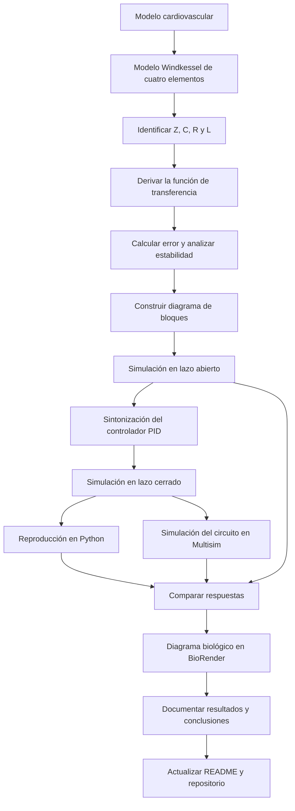

[](https://matlab.mathworks.com/open/github/v1?repo=DrPaulValle/MSFBP0)

# Práctica 5.4 — Sistema cardiovascular: modelo Windkessel de cuatro elementos

Repositorio académico de la asignatura **Modelado de Sistemas Fisiológicos**, correspondiente al programa de **Ingeniería Biomédica** del Tecnológico Nacional de México / Instituto Tecnológico de Tijuana. Esta práctica aborda el modelado matemático de un sistema cardiovascular mediante el modelo Windkessel de cuatro elementos, el análisis de su respuesta dinámica y la aplicación de un controlador PID mediante experimentación *in silico*.

El sistema representa características hemodinámicas del árbol vascular, como la impedancia característica, la distensibilidad arterial, la resistencia periférica y la inertancia de la sangre. Se estudia la presión arterial de entrada \(P_a(t)\) y la presión \(P_p(t)\) sobre la distensibilidad arterial, comparando el comportamiento del modelo en lazo abierto y en lazo cerrado.

**Docente:** Dr. Paul Antonio Valle Trujillo  
**Correo:** paul.valle@tectijuana.edu.mx  
**Departamento:** Ingeniería Eléctrica y Electrónica  
**Institución:** Tecnológico Nacional de México / Instituto Tecnológico de Tijuana  
**Asignatura:** Modelado de Sistemas Fisiológicos  
**Programa:** Ingeniería Biomédica  
**Estudiante:** Nombre completo · Número de control · correo@tijuana.tecnm.mx

**Repositorio de la asignatura:** https://github.com/DrPaulValle/MSF-IBF1020  
**Sede:** Blvd. Alberto Limón Padilla s/n, Tijuana, C. P. 22454, B. C., México.

---

<a id="contenido"></a>
## Contenido

1. [Resumen](#resumen)
2. [Competencia y objetivos](#objetivos)
3. [Relación con el temario](#temario)
4. [Modelo físico y analogía eléctrica](#analogia)
5. [Parámetros del sistema](#parametros)
6. [Formulación matemática](#modelo)
7. [Análisis del error y estabilidad](#analisis)
8. [Señales de entrada y condiciones de simulación](#senales)
9. [Implementación en MATLAB, Simulink y Multisim](#simulacion)
10. [Control en lazo cerrado y sintonización PID](#pid)
11. [Reproducción en Python](#python)
12. [Diagrama biológico](#biologico)
13. [Resultados y verificación cruzada](#resultados)
14. [Flujo de trabajo](#flujo)
15. [Actividades del estudiante](#actividades)
16. [Estructura del repositorio](#estructura)
17. [Requisitos](#requisitos)
18. [Reproducibilidad y entregables](#reproducibilidad)
19. [Referencias](#referencias)

---

<a id="resumen"></a>
## Resumen

La práctica tiene como propósito modelar y analizar el sistema cardiovascular a partir del modelo Windkessel de cuatro elementos. Este modelo se utiliza para representar propiedades hemodinámicas del sistema vascular mediante una analogía eléctrica formada por una impedancia característica \(Z\), una distensibilidad arterial \(C\), una resistencia periférica \(R\) y una inertancia arterial \(L\).

El modelo contiene dos elementos dinámicos, por lo que requiere dos variables de estado: el flujo \(F_L(t)\) a través de la inertancia arterial y la presión \(P_p(t)\) sobre la distensibilidad arterial. La presión arterial \(P_a(t)\) se considera la entrada del sistema y el objetivo es estudiar la respuesta de \(P_p(t)\) ante una señal de presión variable.

La práctica solicita obtener analíticamente la función de transferencia, determinar el error en estado estacionario y la estabilidad en lazo abierto, construir un diagrama de bloques, sintonizar un controlador PID en Simulink y comparar las respuestas obtenidas en Python, Simulink y Multisim. También se debe representar el comportamiento biológico del sistema mediante BioRender y discutir los resultados de la experimentación *in silico*.

**Palabras clave:** sistema cardiovascular; modelo Windkessel; hemodinámica; presión arterial; distensibilidad arterial; resistencia periférica; inertancia; función de transferencia; PID; MATLAB; Simulink; Python; Multisim.

[Volver al contenido](#contenido)

---

<a id="objetivos"></a>
## Competencia y objetivos

### Competencia a desarrollar

Modelizar un sistema fisiológico mediante una analogía eléctrica y herramientas matemáticas, analizar su respuesta y estabilidad, y aplicar técnicas de control clásico para comparar el comportamiento de un sistema cardiovascular representado por el modelo Windkessel de cuatro elementos.

### Objetivo general

Obtener y analizar el modelo matemático del sistema cardiovascular mediante el modelo Windkessel de cuatro elementos, estudiar la presión sobre la distensibilidad arterial ante una presión arterial de entrada variable y comparar las respuestas en lazo abierto y en lazo cerrado con un controlador PID.

### Objetivos específicos

- Identificar el significado fisiológico de \(Z\), \(C\), \(R\) y \(L\) en el modelo Windkessel.
- Distinguir la presión arterial de entrada \(P_a(t)\), el flujo arterial \(F_a(t)\), el flujo a través de la inertancia \(F_L(t)\) y la presión de salida \(P_p(t)\).
- Calcular analíticamente la función de transferencia del sistema cardiovascular.
- Determinar el error en estado estacionario y analizar la estabilidad del modelo en lazo abierto.
- Construir el diagrama de bloques del sistema de acuerdo con la figura 5.8 del documento de la asignatura.
- Diseñar y sintonizar un controlador PID con el bloque **PID Controller** y la herramienta **Tune** de Simulink.
- Simular la respuesta de \(P_p(t)\) ante una señal aleatoria uniforme con la configuración indicada en el documento.
- Comparar las respuestas del sistema en lazo abierto y cerrado en Python, Simulink y Multisim.
- Elaborar un diagrama biológico del sistema cardiovascular con BioRender.
- Documentar y discutir las respuestas obtenidas en la experimentación *in silico*.

[Volver al contenido](#contenido)

---

<a id="temario"></a>
## Relación con el temario

La práctica corresponde al capítulo 5, **Experimentación *in silico*: Modelizado, análisis y control de sistemas fisiológicos**, específicamente al apartado **5.4. Práctica: Sistema cardiovascular** del documento *Modelado de Sistemas Fisiológicos*.

| Área | Contenidos aplicados |
|---|---|
| Modelado matemático | Modelo Windkessel de cuatro elementos y función de transferencia |
| Sistemas de control | Lazo abierto, lazo cerrado, respuesta temporal, error y estabilidad |
| Controladores | Diseño y sintonización de un controlador PID |
| Simulación computacional | Python, MATLAB/Simulink y Multisim |
| Ingeniería Biomédica | Interpretación de variables hemodinámicas y analogía eléctrica del sistema vascular |

La práctica integra conceptos de fisiología cardiovascular, circuitos eléctricos, ecuaciones diferenciales, sistemas de control y simulación numérica.

[Volver al contenido](#contenido)

---

<a id="analogia"></a>
## Modelo físico y analogía eléctrica

### Modelo Windkessel de cuatro elementos

El modelo Windkessel se utiliza para representar características vasculares del sistema cardiovascular. El modelo clásico de dos elementos considera una distensibilidad concentrada y una resistencia periférica. Las ampliaciones posteriores incorporaron un elemento relacionado con la impedancia de la parte proximal del lecho vascular y otro para representar la inercia de la sangre.

El modelo de cuatro elementos de esta práctica está compuesto por \(Z\), \(C\), \(R\) y \(L\). Sus variables principales son:

| Símbolo | Significado en el modelo | Interpretación |
|---|---|---|
| \(P_a(t)\) | Presión arterial de entrada | Presión aplicada a la entrada del modelo |
| \(F_a(t)\) | Flujo hacia la aorta o arteria pulmonar | Flujo arterial de entrada |
| \(F_L(t)\) | Flujo a través de la inertancia arterial | Variable de estado asociada a la inercia de la sangre |
| \(P_p(t)\) | Presión sobre la distensibilidad arterial | Salida que se analiza en la práctica |
| \(Z\) | Impedancia característica | Impedancia característica del lecho vascular proximal |
| \(C\) | Distensibilidad arterial total | Capacidad arterial de distenderse |
| \(R\) | Resistencia periférica | Oposición al flujo en la circulación periférica |
| \(L\) | Inertancia arterial | Efecto de la inercia de la sangre |

### Correspondencia con el circuito eléctrico

La representación eléctrica permite estudiar la dinámica cardiovascular con elementos equivalentes de circuito. En el diagrama de la figura 5.7 del PDF se muestran la entrada \(P_a(t)\), la rama asociada a \(Z\) y \(L\), y la rama que contiene \(C\) y \(R\), con la presión \(P_p(t)\) sobre la distensibilidad.

**Figura de referencia:** consultar la **Figura 5.7, “Modelo Windkessel de cuatro elementos del sistema cardiovascular”**, en el PDF de la asignatura.

> **Importante:** para obtener la función de transferencia, conservar la topología exacta del circuito de la figura 5.7. No se deben intercambiar conexiones ni asumir una función de transferencia sin derivarla a partir del diagrama.

[Volver al contenido](#contenido)

---

<a id="parametros"></a>
## Parámetros del sistema

El documento proporciona los siguientes parámetros para tres condiciones: hipotenso, normotenso y hipertenso.

| Parámetro | Hipotenso | Normotenso | Hipertenso | Unidad indicada |
|---|---:|---:|---:|---|
| \(Z\) | 0.020 | 0.033 | 0.050 | \(\mathrm{mmHg\,s\,ml^{-1}}\) |
| \(C\) | 0.250 | 1.500 | 2.500 | \(\mathrm{ml\,mmHg^{-1}}\) |
| \(R\) | 0.600 | 0.950 | 1.400 | \(\mathrm{mmHg\,s\,ml^{-1}}\) |
| \(L\) | 0.005 | 0.010 | 0.020 | \(\mathrm{mmHg\,s^2\,ml^{-1}}\) |

Estos valores representan los parámetros de referencia del modelo para las tres condiciones fisiológicas. Se recomienda identificar cuál de las condiciones se utiliza en cada simulación y mantener consistencia entre los modelos de Python, Simulink y Multisim.

[Volver al contenido](#contenido)

---

<a id="modelo"></a>
## Formulación matemática

### Función de transferencia

La primera actividad de la práctica consiste en **calcular analíticamente la función de transferencia del sistema cardiovascular** a partir del circuito Windkessel de cuatro elementos.

La función de transferencia relaciona la presión de salida sobre la distensibilidad arterial con la presión arterial de entrada. Para obtenerla:

1. Identificar las corrientes o flujos en cada rama del circuito.
2. Plantear las relaciones de voltaje y corriente equivalentes de \(Z\), \(L\), \(C\) y \(R\), respetando la analogía usada en la figura 5.7.
3. Aplicar las leyes de Kirchhoff al circuito.
4. Transformar las ecuaciones al dominio de Laplace bajo las condiciones iniciales que correspondan al análisis.
5. Despejar la relación entre \(P_p(s)\) y \(P_a(s)\).

La expresión final debe documentarse en el reporte una vez derivada y verificada. No se incluye aquí una función de transferencia asumida, para evitar sustituir el procedimiento analítico que solicita la actividad.

### Variables de estado

La descripción del PDF establece dos variables de estado:

- \(F_L(t)\): flujo a través de la inertancia arterial total.
- \(P_p(t)\): presión sobre la distensibilidad arterial.

Estas variables permiten describir la dinámica del modelo de cuatro elementos. El estudiante debe derivar las ecuaciones diferenciales correspondientes a partir de las relaciones del circuito.

[Volver al contenido](#contenido)

---

<a id="analisis"></a>
## Análisis del error y estabilidad

La segunda actividad consiste en determinar el **error en estado estacionario** y la **estabilidad del sistema en lazo abierto**.

### Error en estado estacionario

A partir de la función de transferencia obtenida, definir la señal de referencia y la salida del modelo. El error se establece como la diferencia entre ambas señales según la configuración del sistema de control. Para calcular su valor en estado estacionario, utilizar el teorema del valor final solo después de comprobar que se cumplen sus condiciones de aplicación.

Registrar en el reporte:

- La expresión del error en el dominio de Laplace.
- La entrada utilizada para el análisis.
- El desarrollo algebraico.
- El valor final obtenido y su interpretación.

### Estabilidad

La estabilidad debe evaluarse a partir de los polos de la función de transferencia del modelo. Para ello:

1. Obtener el denominador de la función de transferencia.
2. Calcular sus raíces.
3. Analizar la ubicación de los polos en el plano complejo.
4. Relacionar los resultados con la respuesta temporal esperada.

No deben reportarse polos ni conclusiones numéricas hasta sustituir los parámetros y verificar la función de transferencia derivada.

[Volver al contenido](#contenido)

---

<a id="senales"></a>
## Señales de entrada y condiciones de simulación

El PDF indica utilizar el bloque **Uniform Random Number** para representar la presión arterial de entrada \(P_a(t)\) y observar el cambio de la presión \(P_p(t)\) sobre la distensibilidad arterial.

### Configuración indicada

| Parámetro del bloque | Valor |
|---|---:|
| Valor mínimo (`min`) | \(-0.2\ \mathrm{V}\) |
| Valor máximo (`max`) | \(1\ \mathrm{V}\) |
| Semilla (`seed`) | 106 |
| Tiempo de muestreo (`Sample time`) | 0.5 s |
| Intervalo de simulación | \(t\in[0,15]\) s |

La señal aleatoria uniforme se aplica como entrada del sistema. Se debe ilustrar el cambio de \(P_p(t)\) en respuesta a \(P_a(t)\), tanto en lazo abierto como en lazo cerrado con el controlador.

**Nota:** respetar los parámetros del bloque tal como aparecen en el PDF. Si el software muestra los nombres de los campos en inglés, utilizar los equivalentes `Minimum`, `Maximum`, `Seed` y `Sample time`, según la versión instalada.

[Volver al contenido](#contenido)

---

<a id="simulacion"></a>
## Implementación en MATLAB, Simulink y Multisim

La práctica solicita determinar la respuesta del sistema en el intervalo de 0 a 15 segundos utilizando **Python, Simulink y Multisim**, tanto en lazo abierto como en lazo cerrado con el controlador.

### Simulink

En Simulink se deben desarrollar las siguientes actividades:

1. Construir el modelo a partir de la función de transferencia calculada analíticamente.
2. Configurar la entrada con el bloque `Uniform Random Number` y los parámetros indicados en la sección anterior.
3. Observar y registrar \(P_p(t)\) como salida del sistema.
4. Construir el diagrama de bloques de acuerdo con la figura 5.8 del documento.
5. Incorporar el controlador PID y utilizar la herramienta **Tune** para sintonizar sus ganancias.
6. Ejecutar las simulaciones en lazo abierto y en lazo cerrado.
7. Guardar las gráficas y los valores de configuración empleados.

### Multisim

Utilizar Multisim para representar el circuito eléctrico equivalente del sistema cardiovascular. La topología debe corresponder al modelo Windkessel de cuatro elementos de la figura 5.7. Registrar las respuestas en lazo abierto y en lazo cerrado, de acuerdo con el montaje y el controlador diseñados.

### Comparación de implementaciones

| Entorno | Propósito | Evidencia que debe guardarse |
|---|---|---|
| MATLAB/Simulink | Implementar el modelo matemático, simular la entrada aleatoria y sintonizar el PID | Modelo, configuración y gráficas |
| Python | Reproducir numéricamente las respuestas | Código y gráficas generadas |
| Multisim | Representar el circuito eléctrico equivalente | Diagrama y respuestas simuladas |

Para que la comparación sea válida, mantener los mismos parámetros fisiológicos, las condiciones de entrada y las ganancias del controlador cuando la implementación lo permita.

[Volver al contenido](#contenido)

---

<a id="pid"></a>
## Control en lazo cerrado y sintonización PID

La práctica solicita diseñar un controlador con el bloque **PID Controller** de Simulink y utilizar la herramienta **Tune** para sintonizar las ganancias \(k_P\), \(k_I\) y \(k_D\).

### Procedimiento

1. Construir la función de transferencia de la planta a partir del circuito Windkessel.
2. Configurar el sistema en lazo abierto y verificar su respuesta.
3. Incorporar el controlador PID en el diagrama de bloques de la figura 5.8.
4. Configurar la retroalimentación según el diagrama implementado.
5. Abrir la herramienta **Tune** del bloque PID Controller.
6. Ajustar el controlador y registrar las ganancias \(k_P\), \(k_I\) y \(k_D\) resultantes.
7. Ejecutar la simulación con la entrada aleatoria uniforme.
8. Comparar la respuesta de lazo abierto con la respuesta de lazo cerrado.

### Registro de las ganancias

Completar esta tabla con los valores obtenidos en Simulink; no sustituirlos por valores supuestos.

| Ganancia | Valor obtenido |
|---|---:|
| \(k_P\) | Pendiente de registrar |
| \(k_I\) | Pendiente de registrar |
| \(k_D\) | Pendiente de registrar |

El análisis debe explicar cómo cambia la presión \(P_p(t)\) al incorporar el controlador y mostrar evidencia gráfica de la simulación. La práctica no proporciona en este apartado valores fijos de ganancias PID, por lo que deben documentarse los resultados de la sintonización propia.

[Volver al contenido](#contenido)

---

<a id="python"></a>
## Reproducción en Python

El PDF solicita obtener en Python la respuesta del sistema en el intervalo \(t\in[0,15]\) segundos, tanto en lazo abierto como en lazo cerrado con el controlador.

El programa debe implementar la función de transferencia derivada, utilizar los parámetros correspondientes al caso fisiológico seleccionado y reproducir la señal de entrada y las respuestas del modelo. Para facilitar la comparación con Simulink y Multisim, documentar:

1. Los parámetros \(Z\), \(C\), \(R\) y \(L\) utilizados.
2. La función de transferencia obtenida analíticamente.
3. La configuración de la señal de entrada y el intervalo temporal.
4. Las ganancias \(k_P\), \(k_I\) y \(k_D\) obtenidas al sintonizar el PID.
5. La respuesta en lazo abierto.
6. La respuesta en lazo cerrado.
7. Las gráficas y cualquier diferencia observada respecto a Simulink.

El documento de la asignatura no especifica en el apartado 5.4 una biblioteca concreta de Python. Las dependencias deben elegirse de acuerdo con el código utilizado y quedar registradas en el repositorio.

[Volver al contenido](#contenido)

---

<a id="biologico"></a>
## Diagrama biológico del sistema cardiovascular

La práctica solicita elaborar un **diagrama biológico del sistema mediante BioRender.com**.

El diagrama debe ayudar a relacionar la representación matemática con el sistema cardiovascular y las variables hemodinámicas que aparecen en el modelo. Debe identificar la presión arterial de entrada, el flujo arterial, la distensibilidad, la resistencia periférica y el componente asociado a la inercia de la sangre, de acuerdo con el modelo Windkessel de cuatro elementos.

Guardar el diagrama final como imagen e incorporarlo al repositorio. En el reporte, explicar brevemente cómo se relacionan los elementos fisiológicos representados con los componentes del modelo eléctrico.

[Volver al contenido](#contenido)

---

<a id="resultados"></a>
## Resultados y verificación cruzada

Los resultados deben mostrar el comportamiento de la presión \(P_p(t)\) frente a la presión arterial de entrada \(P_a(t)\). La comparación debe incluir las implementaciones de Python, Simulink y Multisim, tanto en lazo abierto como en lazo cerrado con el PID.

### Matriz de resultados

| Implementación | Lazo abierto | Lazo cerrado con PID |
|---|---|---|
| MATLAB/Simulink | Agregar gráfica de \(P_p(t)\) y entrada \(P_a(t)\) | Agregar gráfica y ganancias PID utilizadas |
| Python | Agregar gráfica de respuesta | Agregar gráfica y ganancias PID utilizadas |
| Multisim | Agregar diagrama y respuesta simulada | Agregar diagrama y respuesta con controlador |

### Aspectos para discutir

- Correspondencia entre el modelo Windkessel de cuatro elementos y su analogía eléctrica.
- Consistencia entre la función de transferencia derivada y el circuito de referencia.
- Efecto de la elección de parámetros hipotenso, normotenso o hipertenso sobre la respuesta.
- Diferencias entre la respuesta en lazo abierto y en lazo cerrado.
- Efecto de las ganancias \(k_P\), \(k_I\) y \(k_D\) sobre la respuesta.
- Coincidencias y diferencias entre Python, Simulink y Multisim.
- Limitaciones de la representación simplificada y de las condiciones de simulación.

**Resultados del estudiante:** agregar las gráficas generadas, los valores de PID, la condición fisiológica seleccionada y una interpretación propia de las respuestas. No se incluyen resultados numéricos ni mediciones que no estén documentados.

[Volver al contenido](#contenido)

---

<a id="flujo"></a>
## Flujo de trabajo



El flujo reúne el modelado matemático, el análisis del sistema, el diseño del controlador, la experimentación *in silico* y la documentación de resultados.

[Volver al contenido](#contenido)

---

<a id="actividades"></a>
## Actividades del estudiante

### Etapa 1. Modelo y análisis

- [ ] Identificar los cuatro elementos del modelo Windkessel.
- [ ] Explicar el significado de las variables \(P_a(t)\), \(F_a(t)\), \(F_L(t)\) y \(P_p(t)\).
- [ ] Registrar los parámetros de la condición fisiológica seleccionada.
- [ ] Calcular analíticamente la función de transferencia.
- [ ] Determinar el error en estado estacionario.
- [ ] Calcular los polos y analizar la estabilidad en lazo abierto.

### Etapa 2. Simulación del sistema

- [ ] Construir el diagrama de bloques de acuerdo con la figura 5.8.
- [ ] Configurar el bloque `Uniform Random Number` con mínimo \(-0.2\) V, máximo \(1\) V, semilla 106 y tiempo de muestreo de \(0.5\) s.
- [ ] Simular el sistema en el intervalo de 0 a 15 s.
- [ ] Guardar la respuesta en lazo abierto.
- [ ] Diseñar el circuito equivalente en Multisim.
- [ ] Registrar las respuestas simuladas.

### Etapa 3. Diseño del controlador

- [ ] Incorporar el bloque PID Controller en Simulink.
- [ ] Utilizar la herramienta Tune para sintonizar el controlador.
- [ ] Registrar \(k_P\), \(k_I\) y \(k_D\).
- [ ] Simular el sistema en lazo cerrado.
- [ ] Comparar las respuestas en lazo abierto y cerrado.

### Etapa 4. Reproducción y documentación

- [ ] Implementar el modelo en Python.
- [ ] Comparar las respuestas de Python y Simulink.
- [ ] Completar las simulaciones en Multisim.
- [ ] Elaborar el diagrama biológico con BioRender.
- [ ] Agregar gráficas, diagramas y configuración utilizada.
- [ ] Discutir los resultados y las diferencias entre herramientas.
- [ ] Completar este README con las evidencias propias.
- [ ] Publicar los archivos requeridos en el repositorio.

[Volver al contenido](#contenido)

---

<a id="estructura"></a>
## Estructura del repositorio

La siguiente estructura es una propuesta para organizar los archivos de la práctica. Los nombres pueden ajustarse a los archivos realmente generados.

```text
.
├── README.md                         # Descripción y guía de reproducción
├── CITATION.cff                      # Datos de citación del repositorio
├── modelo_cardiovascular.slx         # Modelo de Simulink (nombre sugerido)
├── modelo_cardiovascular.py          # Implementación en Python (nombre sugerido)
├── circuito_windkessel.png           # Circuito o captura de Multisim
├── diagrama_biologico.png            # Diagrama elaborado con BioRender
├── resultados/
│   ├── lazo_abierto_simulink.png
│   ├── lazo_cerrado_simulink.png
│   ├── lazo_abierto_python.png
│   ├── lazo_cerrado_python.png
│   ├── lazo_abierto_multisim.png
│   └── lazo_cerrado_multisim.png
└── docs/
    └── reporte_practica.pdf          # Reporte final (nombre sugerido)
```

Los nombres anteriores son sugerencias de organización, no nombres de archivos que el PDF indique como obligatorios. Actualizar la estructura para que corresponda con los archivos que realmente se entreguen.

[Volver al contenido](#contenido)

---

<a id="requisitos"></a>
## Requisitos

### Software

- MATLAB y Simulink, con acceso al bloque **PID Controller** y la herramienta **Tune**.
- Python y un entorno de ejecución como Visual Studio Code.
- Multisim para la simulación del circuito equivalente.
- BioRender.com para elaborar el diagrama biológico.
- Git y GitHub para documentar y publicar los archivos.

### Archivos y evidencias

- Modelo matemático y desarrollo de la función de transferencia.
- Modelo de Simulink y circuito de Multisim.
- Código de Python.
- Gráficas de lazo abierto y lazo cerrado.
- Ganancias PID registradas.
- Diagrama biológico y reporte de resultados.

[Volver al contenido](#contenido)

---

<a id="reproducibilidad"></a>
## Reproducibilidad y entregables

### Secuencia de reproducción

1. Consultar el documento *Modelado de Sistemas Fisiológicos* y revisar la sección 5.4, páginas impresas 102–104.
2. Identificar el circuito Windkessel de cuatro elementos de la figura 5.7.
3. Seleccionar y registrar los parámetros del caso hipotenso, normotenso o hipertenso.
4. Derivar y verificar la función de transferencia.
5. Calcular el error en estado estacionario y analizar la estabilidad.
6. Construir el diagrama de bloques con base en la figura 5.8.
7. Configurar la entrada aleatoria uniforme y simular de 0 a 15 segundos.
8. Sintonizar el PID con la herramienta Tune y registrar las ganancias.
9. Obtener las respuestas en lazo abierto y cerrado en Simulink.
10. Reproducir el modelo en Python y realizar la simulación en Multisim.
11. Elaborar el diagrama biológico con BioRender.
12. Comparar los resultados, explicar las diferencias y completar el README con las evidencias propias.

### Resultados mínimos esperados

| Entregable | Evidencia |
|---|---|
| Modelo matemático | Desarrollo de la función de transferencia |
| Análisis del sistema | Error en estado estacionario y estabilidad |
| Diagrama de bloques | Modelo conforme a la figura 5.8 |
| Simulink | Modelo y respuestas en lazo abierto y cerrado |
| Controlador PID | Ganancias \(k_P\), \(k_I\) y \(k_D\) obtenidas con Tune |
| Python | Código y gráficas de las respuestas |
| Multisim | Circuito equivalente y respuestas simuladas |
| Diagrama biológico | Imagen elaborada con BioRender |
| Reporte | Discusión de resultados y conclusiones |
| Repositorio | README y archivos utilizados para reproducir la práctica |

### Criterios de presentación académica

En el README final debe distinguirse entre **datos y parámetros proporcionados por el documento**, **resultados generados por el estudiante** y **modificaciones realizadas durante la implementación**. Las gráficas deben incluir nombres de ejes, unidades, leyendas y condiciones de simulación. Las ganancias del PID y las conclusiones deben corresponder a los resultados efectivamente obtenidos.

[Volver al contenido](#contenido)

---

<a id="referencias"></a>
## Referencias

[1] P. A. Valle Trujillo, *Modelado de Sistemas Fisiológicos*, Tecnológico Nacional de México / Instituto Tecnológico de Tijuana, Tijuana, B. C., México, julio de 2023. Sección 5.4, “Práctica: Sistema cardiovascular”, pp. 102–104.

[2] T. Kind, T. J. Faes, J. W. Lankhaar, A. Vonk-Noordegraaf y M. Verhaegen, “Estimation of three- and four-element Windkessel parameters using subspace model identification”, *IEEE Transactions on Biomedical Engineering*, vol. 57, núm. 7, pp. 1531–1538, julio de 2010. https://doi.org/10.1109/TBME.2010.2041351

[3] M. C. Khoo, *Physiological Control Systems: Analysis, Simulation, and Estimation*, 2.ª ed., IEEE Press, 2018.

[4] Repositorio de la asignatura Modelado de Sistemas Fisiológicos. https://github.com/DrPaulValle/MSF-IBF1020
