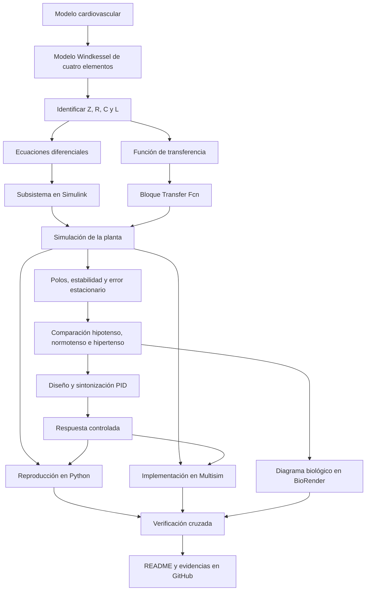

[](https://matlab.mathworks.com/open/github/v1?repo=DrPaulValle/MSF-IBF1020)

# Práctica 5.4 — Sistema cardiovascular

Repositorio académico de la asignatura **Modelado de Sistemas Fisiológicos**, correspondiente al programa de **Ingeniería Biomédica** del Tecnológico Nacional de México / Instituto Tecnológico de Tijuana. Esta práctica estudia el modelado matemático y la simulación del sistema cardiovascular mediante el modelo Windkessel de cuatro elementos, el análisis de estabilidad y error en estado estacionario, y el diseño de un controlador PID.

El sistema se representa mediante una analogía eléctrica que contiene una impedancia característica \(Z\), una inertancia arterial \(L\), una resistencia periférica \(R\) y una distensibilidad arterial \(C\). Se analiza la presión sobre la distensibilidad arterial \(P_p(t)\) en respuesta a una presión arterial de entrada \(P_a(t)\), comparando tres condiciones: hipotensión, normotensión e hipertensión.

**Docente:** Dr. Paul Antonio Valle Trujillo  
**Correo:** [paul.valle@tectijuana.edu.mx](mailto:paul.valle@tectijuana.edu.mx)  
**Departamento:** Ingeniería Eléctrica y Electrónica  
**Institución:** Tecnológico Nacional de México / Instituto Tecnológico de Tijuana  
**Asignatura:** Modelado de Sistemas Fisiológicos  
**Programa:** Ingeniería Biomédica  
**Estudiante:** Nombre completo · Número de control · [correo@tijuana.tecnm.mx](mailto:correo@tijuana.tecnm.mx)

**Repositorio de la asignatura:** [https://github.com/DrPaulValle/MSF-IBF1020](https://github.com/DrPaulValle/MSF-IBF1020)  
**Sede:** Blvd. Alberto Limón Padilla s/n, Tijuana, C. P. 22454, B. C., México.

---

<a id="contenido"></a>
## Contenido

1. [Resumen](#resumen)
2. [Competencia y objetivos](#objetivos)
3. [Relación con el temario](#temario)
4. [Modelo físico y analogía eléctrica](#analogia)
5. [Parámetros cardiovasculares](#parametros)
6. [Formulación matemática](#modelo)
7. [Análisis temporal y de estabilidad](#analisis)
8. [Señal de entrada y condiciones de simulación](#senales)
9. [Implementación en MATLAB, Simulink y Multisim](#implementacion)
10. [Control en lazo cerrado y sintonización PID](#pid)
11. [Reproducción en Python](#python)
12. [Diagrama biológico en BioRender](#biorender)
13. [Resultados y verificación cruzada](#resultados)
14. [Flujo de trabajo](#flujo)
15. [Actividades del estudiante](#actividades)
16. [Estructura del repositorio](#estructura)
17. [Requisitos](#requisitos)
18. [Reproducibilidad y entregables](#reproducibilidad)
19. [Referencias](#referencias)

---

<a id="resumen"></a>
## Resumen

La práctica tiene como propósito modelar y analizar el comportamiento dinámico del sistema cardiovascular mediante el **modelo Windkessel de cuatro elementos**. Este modelo concentra propiedades hemodinámicas relevantes en cuatro parámetros: impedancia característica $Z$, distensibilidad arterial \(C\), resistencia periférica \(R\) e inertancia arterial \(L\). La analogía eléctrica permite formular ecuaciones diferenciales y una función de transferencia para estudiar la presión \(P_p(t)\) sobre la distensibilidad arterial a partir de la presión de entrada \(P_a(t)\).

Se comparan los parámetros proporcionados para un paciente hipotenso, un individuo normotenso y un paciente hipertenso. La respuesta se estudia en el intervalo de \(0\) a \(15\ \mathrm{s}\), utilizando una entrada aleatoria uniforme en Simulink. Posteriormente se analiza el sistema en lazo abierto, se diseña un controlador PID mediante la herramienta **Tune** de Simulink y se contrastan los resultados computacionales en MATLAB/Simulink, Python y Multisim.

La práctica también requiere elaborar un diagrama biológico del sistema cardiovascular en BioRender y discutir cómo los cambios de los parámetros del modelo modifican la respuesta hemodinámica. Los resultados simulados deben distinguirse de las mediciones experimentales y de cualquier modificación realizada por el estudiante.

**Palabras clave:** sistema cardiovascular; modelo Windkessel; impedancia característica; resistencia periférica; distensibilidad arterial; inertancia; función de transferencia; PID; MATLAB; Simulink; Python; Multisim; BioRender.

[Volver al contenido](#contenido)

---

<a id="objetivos"></a>
## Competencia y objetivos

### Competencia a desarrollar

Comprender los fundamentos del modelado matemático de sistemas fisiológicos mediante la representación eléctrica de la dinámica cardiovascular, el análisis de sistemas de segundo orden, la evaluación de estabilidad y error estacionario, y la simulación de estrategias de control.

### Objetivo general

Modelar y analizar el sistema cardiovascular mediante el modelo Windkessel de cuatro elementos, comparando la respuesta de un individuo normotenso con las de casos hipotenso e hipertenso, y verificando el comportamiento del modelo en distintas herramientas de simulación.

### Objetivos específicos

- Identificar la correspondencia entre las variables hemodinámicas y los elementos eléctricos \(Z\), \(L\), \(R\) y \(C\).
- Obtener las ecuaciones diferenciales y la función de transferencia que relacionan \(P_a(t)\) con \(P_p(t)\).
- Determinar los polos, la estabilidad y el error en estado estacionario de la planta.
- Comparar las respuestas correspondientes a hipotensión, normotensión e hipertensión con los parámetros de la práctica.
- Generar la entrada aleatoria uniforme con la configuración especificada en el instructivo.
- Construir el modelo mediante ecuaciones en Simulink y mediante el bloque **Transfer Fcn**.
- Diseñar y sintonizar un controlador PID mediante **PID Controller** y **Tune**.
- Comparar las respuestas en lazo abierto y lazo cerrado en el intervalo de \(0\) a \(15\ \mathrm{s}\).
- Reproducir los resultados en Python y Multisim, e interpretar las posibles diferencias.
- Elaborar un diagrama biológico del sistema cardiovascular en BioRender y documentar los resultados.

[Volver al contenido](#contenido)

---

<a id="temario"></a>
## Relación con el temario

La práctica integra contenidos de modelado matemático, sistemas de control y simulación computacional.

| Área | Contenidos aplicados |
|---|---|
| Modelado de sistemas fisiológicos | Modelo Windkessel de cuatro elementos y analogía hemodinámica-eléctrica |
| Circuitos eléctricos | Impedancia, resistencia, capacitancia, inductancia y leyes de Kirchhoff |
| Sistemas de control | Función de transferencia, polos, estabilidad, error estacionario y retroalimentación |
| Controladores | Control PID y sintonización de ganancias |
| Computación científica | Simulación con MATLAB/Simulink, Python y Multisim |
| Bioingeniería | Interpretación de las variables cardiovasculares y elaboración de un diagrama biológico |

[Volver al contenido](#contenido)

---

<a id="analogia"></a>
## Modelo físico y analogía eléctrica

El **modelo Windkessel** representa de manera concentrada ciertas propiedades hemodinámicas del sistema arterial. El modelo clásico de dos elementos combina una resistencia periférica y una distensibilidad; las versiones ampliadas incorporan la impedancia característica proximal y la inertancia de la sangre.

En esta práctica se emplea el modelo de cuatro elementos:

| Símbolo | Elemento eléctrico | Interpretación cardiovascular |
|---|---|---|
| \(P_a(t)\) | Voltaje de entrada \(V_e(t)\) | Presión arterial aplicada al sistema |
| \(P_p(t)\) | Voltaje de salida \(V_s(t)\) | Presión sobre la distensibilidad arterial |
| \(F_a(t)\) | Corriente de entrada | Flujo sanguíneo de entrada |
| \(F_L(t)\) | Corriente asociada a la inertancia | Flujo a través de la rama inductiva |
| \(Z\) | Impedancia/resistencia característica | Impedancia característica proximal del lecho vascular |
| \(R\) | Resistencia | Resistencia vascular periférica |
| \(C\) | Capacitancia | Distensibilidad arterial total |
| \(L\) | Inductancia | Inertancia arterial asociada a la masa de sangre |

La distensibilidad \(C\) representa la capacidad de las arterias de almacenar volumen ante un cambio de presión. La resistencia \(R\) representa la oposición al flujo sanguíneo, mientras que \(L\) modela el efecto inercial de la sangre. La impedancia \(Z\) representa la oposición característica del segmento vascular proximal.

**Nota de interpretación:** el circuito es una analogía matemática y eléctrica de la hemodinámica; los voltajes y corrientes de simulación no deben interpretarse directamente como presiones y flujos fisiológicos medidos sin definir los factores de escala.

El circuito de referencia se muestra en la **Figura 5.7 del instructivo**. Debe consultarse el diagrama original para confirmar la ubicación exacta de cada componente y los nodos de entrada y salida antes de construir el circuito en Simulink o Multisim.

[Volver al contenido](#contenido)

---

<a id="parametros"></a>
## Parámetros cardiovasculares

El instructivo proporciona los siguientes parámetros para los tres escenarios. Deben introducirse en las unidades indicadas en la tabla.

| Parámetro | Hipotenso | Normotenso (control) | Hipertenso | Unidad |
|---|---:|---:|---:|---|
| \(Z\) | 0.020 | 0.033 | 0.050 | \(\mathrm{mmHg\,s\,ml^{-1}}\) |
| \(C\) | 0.250 | 1.500 | 2.500 | \(\mathrm{ml\,mmHg^{-1}}\) |
| \(R\) | 0.600 | 0.950 | 1.400 | \(\mathrm{mmHg\,s\,ml^{-1}}\) |
| \(L\) | 0.005 | 0.010 | 0.020 | \(\mathrm{mmHg\,s^2\,ml^{-1}}\) |

**Fuente de los parámetros:** Kind et al. (2010), citados en el instructivo de la asignatura.

Los valores de esta tabla corresponden a los escenarios de referencia del documento. Para cada escenario se debe construir la función de transferencia usando el conjunto completo de parámetros correspondiente. No se deben combinar parámetros de diferentes columnas en un mismo modelo.

### Interpretación comparativa

- **Hipotenso:** representa el escenario con los parámetros asignados a la condición hipotensa.
- **Normotenso:** funciona como escenario de control o referencia para comparar las respuestas.
- **Hipertenso:** representa el escenario con los parámetros asignados a la condición hipertensa.

La interpretación debe basarse en la respuesta simulada y en los parámetros definidos por la práctica. No se debe concluir que un solo parámetro explica por sí mismo una condición clínica, ya que los cuatro parámetros cambian entre escenarios.

[Volver al contenido](#contenido)

---

<a id="modelo"></a>
## Formulación matemática

### 1. Ecuaciones del modelo

Para la topología de referencia, la corriente que atraviesa la rama formada por la resistencia \(R\) y la capacitancia \(C\) en paralelo se expresa como:

\[
F_L(t)=F_R(t)+F_C(t)
\]

Las relaciones constitutivas de los elementos son:

\[
F_R(t)=\frac{P_p(t)}{R}
\]

\[
F_C(t)=C\frac{dP_p(t)}{dt}
\]

Por lo tanto,

\[
\boxed{F_L(t)=\frac{P_p(t)}{R}
+C\frac{dP_p(t)}{dt}}
\]

La ley de voltajes para la impedancia característica \(Z\), la inertancia \(L\) y la presión de salida es:

\[
\boxed{P_a(t)=Z F_L(t)+L\frac{dF_L(t)}{dt}+P_p(t)}
\]

Estas ecuaciones describen el comportamiento del circuito Windkessel de cuatro elementos, con \(P_a(t)\) como entrada y \(P_p(t)\) como salida.

### 2. Función de transferencia

Con condiciones iniciales nulas, la transformada de Laplace de la ecuación de la rama paralela es:

\[
F_L(s)=\left(Cs+\frac{1}{R}\right)P_p(s)
\]

La ecuación de entrada queda:

\[
P_a(s)=(Z+Ls)F_L(s)+P_p(s)
\]

Sustituyendo \(F_L(s)\):

\[
P_a(s)=\left[(Z+Ls)\left(Cs+\frac{1}{R}\right)+1\right]P_p(s)
\]

Por tanto, la función de transferencia entre la presión de salida y la presión de entrada es:

\[
\boxed{
G(s)=\frac{P_p(s)}{P_a(s)}
=\frac{R}{LRCs^2+(L+ZRC)s+(Z+R)}
}
\]

La función es de segundo orden porque el modelo contiene dos elementos dinámicos independientes: la inertancia \(L\) y la distensibilidad \(C\).

### 3. Representación mediante ecuaciones diferenciales de primer orden

Tomando como variables de estado:

\[
x_1(t)=P_p(t),\qquad x_2(t)=F_L(t)
\]

se obtiene:

\[
\boxed{\dot{x}_1(t)=\frac{1}{C}
\left(x_2(t)-\frac{x_1(t)}{R}\right)}
\]

\[
\boxed{\dot{x}_2(t)=\frac{P_a(t)-Zx_2(t)-x_1(t)}{L}}
\]

y la salida es:

\[
\boxed{y(t)=x_1(t)=P_p(t)}
\]

Estas ecuaciones pueden implementarse en un subsistema de Simulink mediante bloques de suma, ganancias e integradores.

### 4. Ejemplo de definición de la planta en MATLAB

El siguiente ejemplo construye la función de transferencia para el escenario normotenso. Requiere **Control System Toolbox**.

```matlab
% Parametros del escenario normotenso
Z = 0.033;
C = 1.500;
R = 0.950;
L = 0.010;

% Funcion de transferencia Pp(s)/Pa(s)
num = R;
den = [L*R*C, L + Z*R*C, Z + R];

G = tf(num, den);

% Polos y ganancia estatica
polos = pole(G)
ganancia_estatica = dcgain(G)
```

Se deben repetir los cálculos para los escenarios hipotenso e hipertenso cambiando los cuatro parámetros por los valores de la tabla anterior.

[Volver al contenido](#contenido)

---

<a id="analisis"></a>
## Análisis temporal y de estabilidad

### 1. Error en estado estacionario

La ganancia estática se obtiene evaluando la función de transferencia en \(s=0\):

\[
\boxed{G(0)=\frac{R}{Z+R}}
\]

Para una entrada escalón de amplitud \(A\), si el sistema es estable:

\[
\lim_{t\to\infty}P_p(t)=A\frac{R}{Z+R}
\]

El error entre la entrada y la salida, definido como \(e(t)=P_a(t)-P_p(t)\), es:

\[
\boxed{e_{ss}=A\left(1-\frac{R}{Z+R}\right)
=A\frac{Z}{Z+R}}
\]

Por tanto, la salida no alcanza exactamente la entrada en estado estacionario cuando \(Z>0\). Este resultado corresponde a una entrada escalón y a la función de transferencia definida en esta práctica.

### 2. Polos y estabilidad

Los polos se obtienen de las raíces del denominador:

\[
LRCs^2+(L+ZRC)s+(Z+R)=0
\]

Por la fórmula general:

\[
\boxed{
s_{1,2}=
\frac{-(L+ZRC)\pm
\sqrt{(L+ZRC)^2-4LRC(Z+R)}}
{2LRC}
}
\]

Para parámetros positivos \(Z,R,L,C>0\), los coeficientes del polinomio característico son positivos. Para un sistema continuo de segundo orden, esto implica polos con parte real negativa y, por tanto, estabilidad asintótica.

Debe calcularse el discriminante para cada escenario y verificar si los polos son reales o complejos. La estabilidad no debe decidirse solo a partir de la apariencia de las gráficas: se deben reportar los polos obtenidos numéricamente.

### 3. Comparación entre escenarios

Para cada uno de los tres conjuntos de parámetros:

1. Construir \(G(s)\).
2. Calcular los polos y la ganancia estática.
3. Simular la respuesta con la misma señal de entrada.
4. Comparar amplitud, transitorio, valor medio y rapidez de respuesta.
5. Relacionar las diferencias con los cambios simultáneos de \(Z\), \(R\), \(C\) y \(L\).

[Volver al contenido](#contenido)

---

<a id="senales"></a>
## Señal de entrada y condiciones de simulación

El instructivo solicita una entrada de tipo **Uniform Random Number** en Simulink, con los siguientes parámetros:

| Parámetro | Configuración |
|---|---:|
| Minimum | \(0.2\ \mathrm{V}\) |
| Maximum | \(1\ \mathrm{V}\) |
| Seed | \(106\) |
| Sample time | \(0.5\ \mathrm{s}\) |
| Intervalo de simulación | \(0\) a \(15\ \mathrm{s}\) |

La entrada aleatoria permite observar cómo responde la presión \(P_p(t)\) ante una señal variable. Para comparar los tres escenarios, se recomienda conservar la misma configuración de entrada y documentar la semilla utilizada.

**Importante:** el tiempo de muestreo de \(0.5\ \mathrm{s}\) es la configuración indicada para el bloque de entrada aleatoria; no equivale necesariamente al paso del solver de todo el modelo. El solver y sus opciones deben configurarse de forma consistente con la dinámica de la planta.

[Volver al contenido](#contenido)

---

<a id="implementacion"></a>
## Implementación en MATLAB, Simulink y Multisim

La práctica requiere representar el sistema cardiovascular mediante dos implementaciones en Simulink y realizar la comparación computacional correspondiente.

| Implementación | Descripción | Verificación |
|---|---|---|
| Ecuaciones diferenciales, Simulink | Subsistema con las ecuaciones de estado, integradores y ganancias | Consistencia con las ecuaciones del modelo |
| Función de transferencia, Simulink | Bloque **Transfer Fcn** con el numerador y denominador calculados | Concordancia entre la respuesta del bloque y la del subsistema |
| Circuito eléctrico, Multisim | Implementación de la analogía con \(Z\), \(L\), \(R\) y \(C\) | Comparación de la respuesta eléctrica con las simulaciones matemáticas |

### Coeficientes para el bloque Transfer Fcn

Para cada escenario, el bloque debe configurarse con:

- **Numerator:** `[R]`
- **Denominator:** `[L*R*C, L + Z*R*C, Z + R]`

Se pueden calcular previamente los coeficientes en MATLAB y asignarlos al bloque. Se debe verificar que el orden de los coeficientes coincida con las potencias descendentes de \(s\).

### Comparación de escenarios

Los escenarios hipotenso, normotenso e hipertenso se deben simular por separado, actualizando \(Z\), \(C\), \(R\) y \(L\). En las figuras se recomienda identificar claramente el escenario, la señal de entrada y la presión de salida.

[Volver al contenido](#contenido)

---

<a id="pid"></a>
## Control en lazo cerrado y sintonización PID

### 1. Estructura de control

El instructivo plantea un diagrama de bloques en el que la respuesta de un individuo sano o normotenso sirve como referencia para formular un protocolo de tratamiento para un paciente. En la representación de control, el error se calcula como la diferencia entre la referencia y la salida del caso:

\[
e(t)=r(t)-P_{p,\mathrm{caso}}(t)
\]

El controlador PID genera una señal de control a partir del error:

\[
u(t)=k_Pe(t)+k_I\int_0^t e(\tau)\,d\tau
+k_D\frac{de(t)}{dt}
\]

En el dominio de Laplace, para el PID ideal:

\[
K(s)=k_P+\frac{k_I}{s}+k_Ds
\]

Si se utiliza retroalimentación negativa unitaria sobre una planta \(G(s)\), la función de transferencia de lazo cerrado es:

\[
\boxed{T(s)=\frac{K(s)G(s)}{1+K(s)G(s)}}
\]

La implementación exacta debe respetar el diagrama de bloques del instructivo y la forma en que se conectan la referencia, el controlador y el modelo del paciente. No debe suponerse que una conexión de retroalimentación unitaria representa por sí sola todo el protocolo de tratamiento descrito en la práctica.

### 2. Sintonización

1. Construir el diagrama de bloques indicado en la Figura 5.8 del instructivo.
2. Insertar el bloque **PID Controller** en la ubicación indicada.
3. Abrir la herramienta **Tune** y sintonizar \(k_P\), \(k_I\) y \(k_D\).
4. Registrar las ganancias y los ajustes del controlador.
5. Comparar la respuesta del caso con la referencia normotensa antes y después del control.
6. Documentar las diferencias entre la respuesta en lazo abierto y la respuesta controlada.

El instructivo de esta práctica no especifica en el apartado cardiovascular un límite numérico de tiempo de establecimiento o sobreimpulso. Por ello, no se deben inventar criterios de aceptación: se reportan los valores medidos en la simulación y los requisitos adicionales que indique el docente.

[Volver al contenido](#contenido)

---

<a id="python"></a>
## Reproducción en Python

Python permite contrastar la respuesta de la planta con los resultados obtenidos en MATLAB/Simulink. La implementación debe utilizar los mismos parámetros, condiciones iniciales, señal de entrada y tiempo de simulación.

El programa debe incluir, como mínimo:

1. Definición de \(Z\), \(C\), \(R\) y \(L\) para cada escenario.
2. Construcción de la función de transferencia.
3. Cálculo de polos y ganancia estática.
4. Generación o importación de la misma señal de entrada aleatoria.
5. Simulación de la respuesta \(P_p(t)\) en el intervalo de \(0\) a \(15\ \mathrm{s}\).
6. Implementación del controlador PID, usando las ganancias obtenidas con Tune.
7. Generación de gráficas comparativas y almacenamiento de los resultados.

**Reproducibilidad de la señal:** para que la comparación sea válida, es preferible guardar la secuencia de entrada generada en Simulink y reutilizarla en Python. Usar únicamente la misma semilla en dos entornos no garantiza que ambos generadores produzcan exactamente la misma secuencia.

Las dependencias de Python deben identificarse a partir de las bibliotecas importadas por el script utilizado. No se asignan valores ficticios a las ganancias PID ni se presentan resultados que no hayan sido simulados.

[Volver al contenido](#contenido)

---

<a id="biorender"></a>
## Diagrama biológico en BioRender

La práctica solicita elaborar un diagrama biológico del sistema cardiovascular utilizando BioRender. El esquema debe ayudar a relacionar los elementos del modelo con las estructuras fisiológicas representadas.

Se recomienda incluir:

- Corazón como fuente de presión y flujo sanguíneo.
- Aorta y arterias proximales, asociadas conceptualmente con la impedancia característica \(Z\).
- Propiedades elásticas de las arterias, asociadas con la distensibilidad \(C\).
- Lecho vascular periférico, asociado con la resistencia \(R\).
- Inercia del flujo sanguíneo, representada por \(L\).
- Flechas que indiquen el sentido del flujo y etiquetas para \(P_a(t)\) y \(P_p(t)\).
- Una leyenda que distinga el escenario hipotenso, normotenso e hipertenso.

El diagrama biológico es una representación explicativa, no una medición anatómica directa de los parámetros eléctricos. Debe mantener correspondencia con las definiciones y la topología del modelo matemático.

[Volver al contenido](#contenido)

---

<a id="resultados"></a>
## Resultados y verificación cruzada

La comparación debe realizarse con las mismas condiciones de entrada y los parámetros correspondientes a cada escenario.

### Resultados que se deben documentar

| Resultado | MATLAB/Simulink | Python | Multisim |
|---|---|---|---|
| Respuesta de la planta hipotensa | Agregar figura propia | Agregar figura propia | Agregar captura propia |
| Respuesta de la planta normotensa | Agregar figura propia | Agregar figura propia | Agregar captura propia |
| Respuesta de la planta hipertensa | Agregar figura propia | Agregar figura propia | Agregar captura propia |
| Polos y estabilidad | Registrar cálculo | Verificar cálculo | No aplica directamente si no se extraen polos |
| Respuesta con PID | Agregar figura propia | Agregar figura propia | Agregar captura si se implementó el controlador |

### Aspectos para discutir

- Concordancia entre el subsistema de ecuaciones y el bloque **Transfer Fcn**.
- Diferencias entre las respuestas hipotensa, normotensa e hipertensa.
- Efecto de los cambios de \(Z\), \(R\), \(C\) y \(L\) en la ganancia estática y la dinámica.
- Estabilidad del sistema a partir de sus polos.
- Diferencia entre entrada y salida en estado estacionario.
- Efecto del controlador PID en el seguimiento de la referencia.
- Concordancia entre MATLAB/Simulink, Python y Multisim.
- Limitaciones del modelo concentrado y posibles fuentes de discrepancia numérica.

**Resultados del estudiante:** agregar las gráficas, las ganancias PID realmente obtenidas, los polos calculados y una interpretación propia de los resultados. Las figuras de ejemplo o las capturas del instructivo no deben presentarse como resultados experimentales propios.

[Volver al contenido](#contenido)

---

<a id="flujo"></a>
## Flujo de trabajo



El procedimiento combina formulación matemática, simulación computacional, análisis de control y representación fisiológica. Las etapas deben documentarse para que otra persona pueda reproducir los resultados.

[Volver al contenido](#contenido)

---

<a id="actividades"></a>
## Actividades del estudiante

### Etapa 1. Modelo y análisis matemático

- [ ] Identificar \(P_a(t)\), \(P_p(t)\), \(F_L(t)\), \(Z\), \(R\), \(C\) y \(L\).
- [ ] Formular las ecuaciones integro-diferenciales o diferenciales del circuito.
- [ ] Obtener la función de transferencia \(P_p(s)/P_a(s)\).
- [ ] Calcular los polos y la ganancia estática.
- [ ] Determinar el error en estado estacionario para una entrada escalón.
- [ ] Repetir el análisis para los escenarios hipotenso, normotenso e hipertenso.

### Etapa 2. Simulación

- [ ] Construir el modelo mediante ecuaciones en un subsistema de Simulink.
- [ ] Construir el modelo mediante el bloque **Transfer Fcn**.
- [ ] Configurar la entrada aleatoria con los valores del instructivo.
- [ ] Simular entre \(0\) y \(15\ \mathrm{s}\).
- [ ] Comparar los tres escenarios fisiológicos.
- [ ] Verificar la concordancia entre ambas representaciones.

### Etapa 3. Control y reproducción

- [ ] Construir el diagrama de bloques correspondiente a la Figura 5.8.
- [ ] Diseñar y sintonizar el PID mediante **Tune**.
- [ ] Registrar \(k_P\), \(k_I\) y \(k_D\).
- [ ] Comparar la respuesta del caso con la referencia y con la respuesta controlada.
- [ ] Reproducir la respuesta en Python usando la misma entrada.
- [ ] Implementar o verificar el circuito en Multisim, según el procedimiento indicado.

### Etapa 4. Interpretación y documentación

- [ ] Elaborar el diagrama biológico en BioRender.
- [ ] Guardar las gráficas y capturas de simulación.
- [ ] Comparar los resultados de MATLAB/Simulink, Python y Multisim.
- [ ] Discutir el efecto de los parámetros y las limitaciones del modelo.
- [ ] Completar este README con las evidencias y conclusiones propias.
- [ ] Incorporar las fuentes y los archivos necesarios para reproducir el trabajo.

[Volver al contenido](#contenido)

---

<a id="estructura"></a>
## Estructura del repositorio

La siguiente estructura es una propuesta para organizar los archivos de la práctica. Los nombres pueden ajustarse a los archivos reales del estudiante.

```text
.
├── README.md
├── CITATION.cff
├── Practica54_SistemaCardiovascular.mlx
├── Practica54_SistemaCardiovascular.pdf
├── modelo_cardiovascular.slx
├── modelo_cardiovascular.py
├── circuito_windkessel.png
├── diagrama_biologico_biorender.png
├── respuesta_hipotenso_matlab.png
├── respuesta_normotenso_matlab.png
├── respuesta_hipertenso_matlab.png
├── respuesta_pid.png
└── evidencias/
    ├── simulink/
    ├── python/
    └── multisim/
```

**Importante:** esta estructura es sugerida y no afirma que esos archivos ya existan. Actualiza los nombres y las rutas de acuerdo con los archivos que realmente agregues al repositorio. No incluyas enlaces a figuras que todavía no hayas subido.

[Volver al contenido](#contenido)

---

<a id="requisitos"></a>
## Requisitos

### Software

- **MATLAB** para los cálculos y la construcción de la función de transferencia.
- **Simulink** para el subsistema de ecuaciones, el bloque **Transfer Fcn**, la señal aleatoria y el controlador PID.
- **Control System Toolbox** para funciones como `tf`, `pole` y `dcgain` en los ejemplos MATLAB.
- **Python** y un entorno de ejecución, por ejemplo Visual Studio Code.
- **Multisim** para la implementación o comparación del circuito eléctrico, conforme a los recursos disponibles.
- **BioRender** para elaborar el diagrama biológico.
- **Git y GitHub** para versionar y presentar el trabajo.

### Recursos de la práctica

- PDF del instructivo de la asignatura.
- Parámetros de los escenarios hipotenso, normotenso e hipertenso.
- Diagrama de referencia del modelo Windkessel de cuatro elementos.
- Archivos de Simulink, Python y Multisim, si fueron proporcionados por el docente.

[Volver al contenido](#contenido)

---

<a id="reproducibilidad"></a>
## Reproducibilidad y entregables

### Secuencia de reproducción

1. Consultar el [repositorio general de la asignatura](https://github.com/DrPaulValle/MSF-IBF1020) y descargar los recursos correspondientes a la práctica.
2. Revisar la topología del modelo Windkessel de cuatro elementos en la Figura 5.7 del instructivo.
3. Introducir los parámetros \(Z\), \(C\), \(R\) y \(L\) de cada escenario.
4. Obtener la función de transferencia y verificar los coeficientes del denominador.
5. Construir el subsistema de ecuaciones y el bloque **Transfer Fcn** en Simulink.
6. Configurar la entrada aleatoria: mínimo \(0.2\ \mathrm V\), máximo \(1\ \mathrm V\), semilla \(106\) y tiempo de muestreo \(0.5\ \mathrm s\).
7. Simular en el intervalo de \(0\) a \(15\ \mathrm s\).
8. Calcular polos, ganancia estática y error estacionario.
9. Construir el diagrama de control de la Figura 5.8 y sintonizar el PID.
10. Reproducir los resultados en Python y contrastarlos con Simulink.
11. Comparar con Multisim, cuando se cuente con la implementación correspondiente.
12. Elaborar el diagrama biológico en BioRender.
13. Agregar las figuras, ganancias obtenidas, análisis y conclusiones al repositorio.

### Resultados mínimos esperados

| Entregable | Evidencia |
|---|---|
| Modelo matemático | Ecuaciones diferenciales y función de transferencia |
| Análisis del sistema | Polos, estabilidad, ganancia estática y error estacionario |
| Comparación fisiológica | Resultados para hipotenso, normotenso e hipertenso |
| Simulink | Modelo de ecuaciones y modelo con **Transfer Fcn** |
| Entrada de simulación | Configuración documentada de **Uniform Random Number** |
| Control PID | Diagrama de bloques, ganancias sintonizadas y respuesta |
| Python | Código fuente y gráficas comparables |
| Multisim | Circuito y capturas, si se implementó |
| BioRender | Diagrama biológico del sistema cardiovascular |
| Documentación | README, referencias, evidencias y conclusiones propias |

### Criterios de presentación académica

En el README final se debe distinguir entre resultados de referencia, resultados simulados por el estudiante y mediciones experimentales propias. Las figuras deben identificar las variables, las unidades, el escenario fisiológico y las condiciones de simulación. Las ganancias PID y las conclusiones deben corresponder a resultados realmente obtenidos.

[Volver al contenido](#contenido)

---

<a id="referencias"></a>
## Referencias

1. Kind, T., Faes, T. J., Lankhaar, J. W., Vonk-Noordegraaf, A., & Verhaegen, M. (2010). “Estimation of three- and four-element Windkessel parameters using subspace model identification”. *IEEE Transactions on Biomedical Engineering*, 57(7), 1531–1538. [https://doi.org/10.1109/TBME.2010.2041351](https://doi.org/10.1109/TBME.2010.2041351)

2. Valle Trujillo, P. A. *Modelado de Sistemas Fisiológicos: Práctica 5.4, Sistema cardiovascular*. Tecnológico Nacional de México / Instituto Tecnológico de Tijuana, sección de prácticas de experimentación *in silico*.

3. Khoo, M. C. (2018). *Physiological Control Systems: Analysis, Simulation, and Estimation* (2nd ed.). IEEE Press.

4. Ogata, K. (2010). *Ingeniería de Control Moderna* (5.ª ed.). Pearson Educación.

---

## Uso académico

Este repositorio documenta una práctica de **Modelado de Sistemas Fisiológicos** centrada en el sistema cardiovascular y el modelo Windkessel de cuatro elementos. Su finalidad es desarrollar habilidades de formulación matemática, análisis dinámico, diseño de controladores, simulación computacional e interpretación fisiológica. Los parámetros, las condiciones de simulación, las ganancias de control y los resultados deben documentarse de manera reproducible, identificando claramente cualquier modificación propia.
